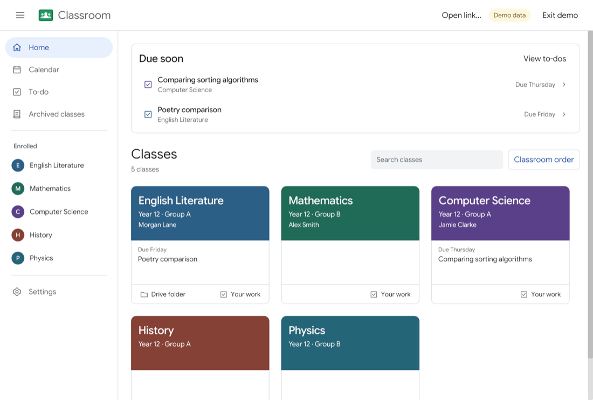

# Classroom for Mac

A native Google Classroom client for Apple Silicon Macs, built with Rust and Iced.



Open classes, browse Stream and Classwork, check deadlines and submissions, and see released grades. The app keeps archived classes in a separate view, loads pages as you open them, and can save an optional SQLite offline copy. Google sign-in and Google Docs editing open in their own browser windows.

## Build on macOS

Install Rust, `protoc`, and Python 3.12. The native app includes a demo with sample data that runs without signing in.

```sh
cargo test --locked --features desktop --all-targets
cargo run --locked --features desktop --bin classroom-desktop
```

To set up live sign-in and build a local app bundle, run these commands from the checkout.

```sh
python3.12 -m venv desktop/runtime/venv
desktop/runtime/venv/bin/python -m pip install -r desktop/requirements.txt
PLAYWRIGHT_BROWSERS_PATH="$PWD/desktop/runtime/browsers" \
  desktop/runtime/venv/bin/python -m playwright install chromium

cargo build --release --locked --features desktop --bin classroom-desktop
bash desktop/package-macos.sh
open "dist/Classroom for Mac.app"
```

The packaging script also accepts the executable and destination as positional arguments. Running it again replaces the existing Classroom bundle after signing and verifying the new one.

## Sign in and use Classroom

Use an account you are authorised to access. Sign-in uses an unofficial Android route and can fail if Google's or your organisation's policy changes. The app stores the long-lived sign-in credential in macOS Keychain so you can reopen it without signing in again. Choose **Sign out** to remove that credential.

Live verification has focused on read-only Google Workspace workflows. Account changes, submission writes and teacher actions are tested with offline fixtures. See [desktop features and verification](DESKTOP.md) for coverage and remaining gaps.

## Project notes

- [Desktop application](src/bin/classroom-desktop/) contains native screens, feature state, shared controls, and the system appearance palette. The [update modules](src/bin/classroom-desktop/update/) define feature messages and handle user actions and background results. The [desktop tests](src/bin/classroom-desktop/tests.rs) exercise navigation and workflows.
- [Backend modules](src/desktop_auth/) handle Classroom and Drive requests. [Protocol definitions](proto/) describe the messages they exchange. [macOS packaging](desktop/) contains the bundle script and its runtime helpers.
- [Release tags](https://github.com/harrisonk0/classroom-rs/tags)
- [Recovered protocol evidence](analysis/feature-parity.md)
- [Earlier protocol and OAuth experiments](analysis/protocol-notes.md)

Classroom for Mac is an independent project.
